<p align="center">
  
</p>

<h1 align="center">易组网 / EasyTier-EUI</h1>


[//]: # ([![Ask DeepWiki]&#40;https://deepwiki.com/badge.svg&#41;]&#40;https://deepwiki.com/710850609/EasyTier-EUI&#41;)

## 目录

- [简介](#简介)
- [快速开始](#快速开始)
- [功能简介](#功能简介)
- [UI界面说明](#UI界面说明)
- [Android 版本说明](#android-版本说明)
- [技术栈](#技术栈)
- [开发运行](#开发运行)
- [其他链接](#其他链接)
- [贡献](#贡献)
- [支持项目](#支持项目)
- [开源协议](#开源协议)

## 简介

<p>简化使用EasyTier的一种UI界面，快速组网（关闭后不影响组网运行）</p>

## 快速开始

### 直接运行

1. 前往 [Releases](https://github.com/710850609/EasyTier-EUI/releases) 页面，下载对应平台的安装包
2. 运行程序包 ```EasyTier-EUI```
3. 在「配置」页面添加组网配置，新手推荐快速模式配置，填入网络名和密钥即可
4. 其它设备加入虚拟网络：在「应用」菜单，根据设备系统架构选择对应安装包，根据页面说明，加入组网
5. 在「节点」页面查看组网状态，完成！

> Linux 版本启动时会尝试打开本地浏览器访问页面；若没有浏览器或处于无图形界面环境，会在命令窗口中显示访问地址和二维码，可通过同一局域网内的其它设备（如手机扫码）访问。

### Docker 部署

使用 `docker-compose.yml` 一键启动：

```bash
# 一键下载配置并启动
wget https://raw.githubusercontent.com/710850609/EasyTier-EUI/main/docker-compose.yml && mkdir -p ./config ./logs && docker compose up -d --pull always
```

配置文件和数据将保存在当前目录下的 `config` 和 `logs` 目录中。

Docker 镜像支持多架构：

| 架构 | 镜像标签 |
|:---|:---|
| amd64 / aarch64 / riscv64 | `latest`（正式版） |
| amd64 / aarch64 / riscv64 | `edge`（预发版） |
| amd64 / aarch64 / riscv64 | `dev`（开发版） |

访问地址：`http://<宿主机IP>:15666`


## 功能简介
- 支持多平台

| 平台            | 架构                              | 备注                                                                                                                              |
|---------------|---------------------------------|---------------------------------------------------------------------------------------------------------------------------------|
| FnOS / FygoOS | x86_64, aarch64                 | 正常版 (以 root 权限运行)</br> 用户版本 (为适配官方上架要求，非 root 应用)                                                                               |
| Windows       | x86_64                          | Windows10及其以上版本                                                                                                                 |
| Linux         | x86_64, aarch64, armv7, riscv64 | 支持有图形界面 (GUI) 和无图形界面 (Headless) <br> 支持 glibc >= 2.28 <br> 支持 musl Linux <br> 已验证支持最低版本：Ubuntu 20.04 / Debian 10 / UOS 20；</br> |
| MacOS         | Intel, arm64                    | 未验证                                                                                                                             |
| Android       | arm64-v8a, armeabi-v7a          | Android 8.0+ (API 26+) <br> 基于 WebView + Chaquopy(Python) + FFI 实现 <br> 通过 Android VPN Service 创建 TUN 虚拟网卡                              |
| Docker        | x86_64, aarch64, riscv64        | 支持标签 latest（正式版）/ edge（预发版）/ dev（开发版）                                                                                           |

### 核心特色
- **一键快速组网**：仅填入网络名和密钥即可秒级启动，关闭界面不影响组网运行
- **跨平台支持**：Windows / macOS / Linux / Android / Docker / FnOS 一套界面统一管理
- **完整的组网资源**：内置各平台组网应用下载、快速组网指引与 Docker 使用说明
- **可视化配置**：图形化编辑 EasyTier 常见配置项，冷门配置可直接编辑配置文件
- **多语言界面**：简体中文 / 繁體中文 / English / Deutsch / Français
- **Android 便捷控制**：快捷设置磁贴静默启停 VPN，减少运存占用
- **系统托盘常驻**：Windows / macOS 版本支持系统托盘开关（可在设置页关闭）

核心功能详见下面的 [UI界面说明](#UI界面说明)。

## UI界面说明
### 节点
- 查看各个节点的组网状态：延迟、穿透方式、NAT类型、连接协议等
- 支持查看节点中继路径
- 支持查看节点子网路由和代理协议（KCP/QUIC 等，安卓版不支持）
- 主机名列悬浮显示对应服务节点的 URI
- 支持按需设置显示列信息、显示普通节点、服务节点、代理/协议
- 支持设置数据刷新速度
- 支持查看 EasyTier 运行日志

### 配置
- 支持多种新增模式：快速模式（仅填网络名和密钥）、自定义模式、扫描二维码添加、从剪贴板导入
- 支持界面可视化配置```EasyTier```常见配置项。对于冷门配置，可通过界面编辑文件的形式进行手动编辑配置内容
- 支持多个配置，配置改名、删除
- 支持设置开机自启（安卓版本为「启动重连」：打开应用/启动指定配置时自动恢复该配置的组网，默认开启，可在配置页针对单个配置精细化控制）
- 支持分享网络：生成二维码或复制到剪贴板，将当前配置分享给其它设备
- 支持服务节点检测，包括：可用性、延迟、可中转
- 支持子网代理（含网段映射）、UDP广播中继、连接代理、自定义路由、端口转发、出口节点、socks5 代理
- 支持自定义魔法 DNS 顶级域名
- 支持本机检测初始节点连通
- 内置 EasyTier 文档与 DeepWiki AI 问答入口，方便查阅配置说明

### 应用
- 支持```EasyTier```其它平台、架构的组网应用下载，包括：Windows、Linux、MacOS、FnOS、Android、IOS、HarmonyOS，方便下载安装，为快速组网作准备。
- ```易组网```, ```easytier-manager-pro```2种应用下载时，会内置当前设备组网配置，以方便快速组网
- Docker 页面提供使用说明

### STUN
- 支持 STUN 监听地址配置（参考亮一光大佬实现），提供 NAT 穿透辅助
- 支持端口转发，解决应用端口冲突问题
- FnOS / FygoOS / Docker 版本支持开机运行
- 安卓版本暂不支持，其它版本仅支持随应用启动

### 日志
- 查看 EasyTier 运行日志，方便排查问题

### 设置
- 支持设置界面主题，包括：暗黑模式、亮色模式、毛玻璃效果开关
- 支持多语言切换（简体中文 / 繁體中文 / English / Deutsch / Français）
- Windows / macOS 版本支持系统托盘开关（可在设置页关闭）
- 支持```EasyTier```查看各个版本的更新内容、GitHub下载量、安装指定内核版本。无须访问GitHub，即可查看最新和历史版本信息。
- 支持```易组网```稳定版、预发版查看更新内容、自更新
- 支持设置自定义可选初始节点（数据来自网络社区）
- 支持 GitHub 辅助下载，内置多代理节点自动测速择优，方便前端设备下载 GitHub 资源
- 支持自定义服务 IP 和端口
- 支持清理日志和缓存
- 支持开发者选项


## 界面

### 大屏界面

| 节点管理 | 配置管理 |
|----------|----------|
| 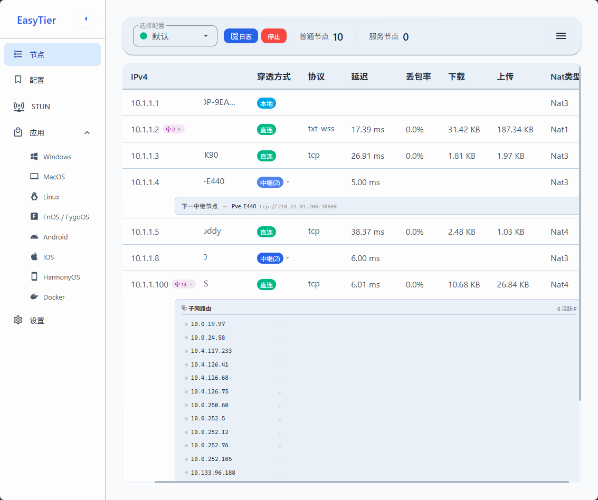 | 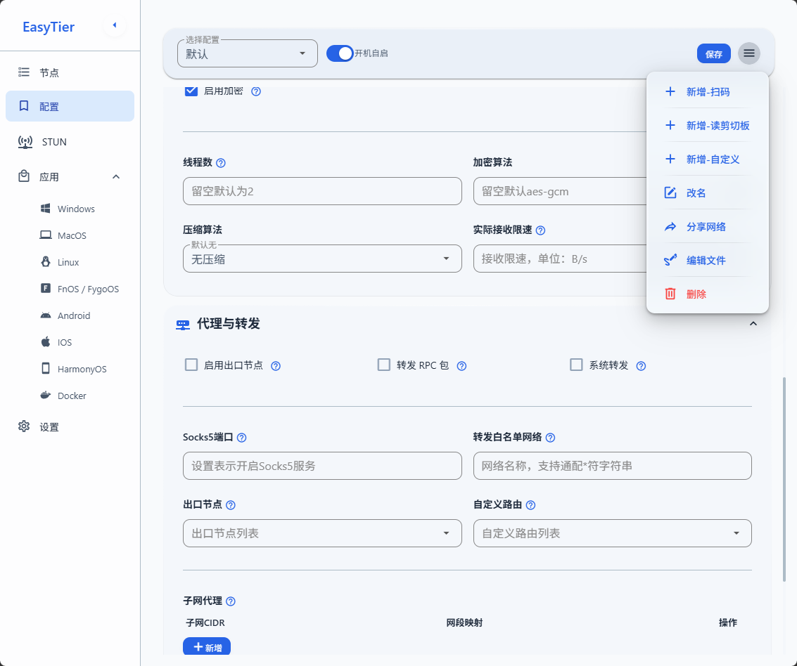 |
| 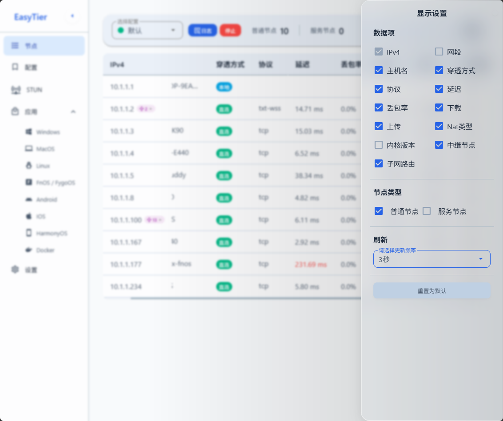 | 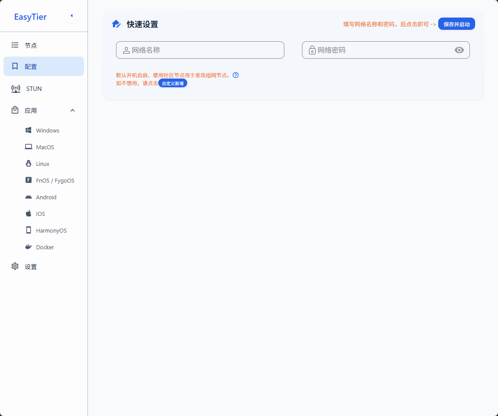 |

| 配置管理 | 应用下载 |
|----------|----------|
| 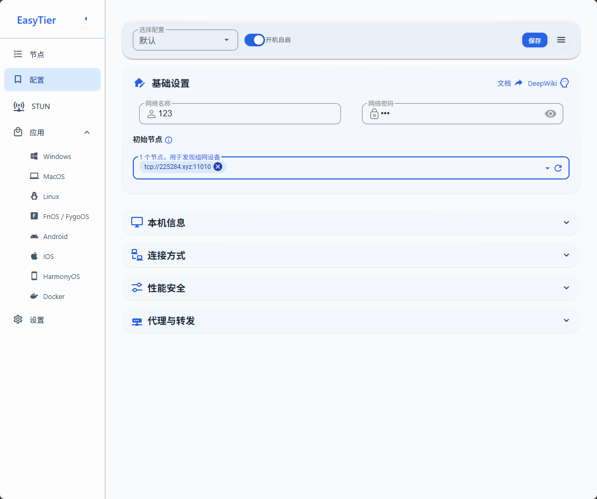 | 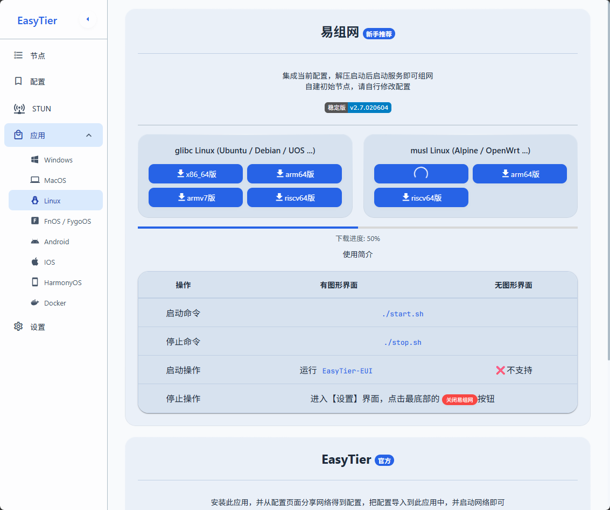 |

| 设置 |
|------|
| 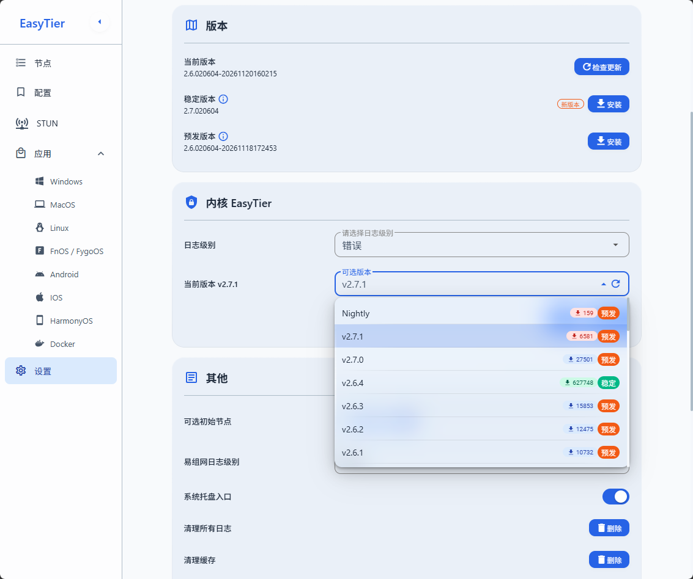 |

### 小屏界面

| 节点管理 | 节点管理 | 配置管理 |
|----------|----------|----------|
| 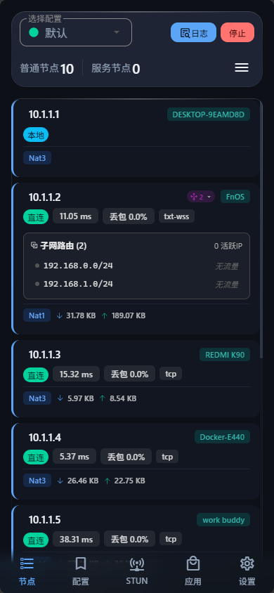 | 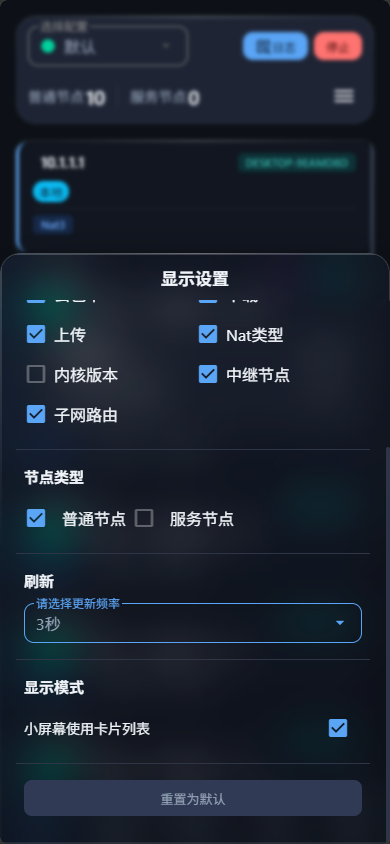 |  |

| 配置管理 | 配置管理 |
|----------|----------|
| 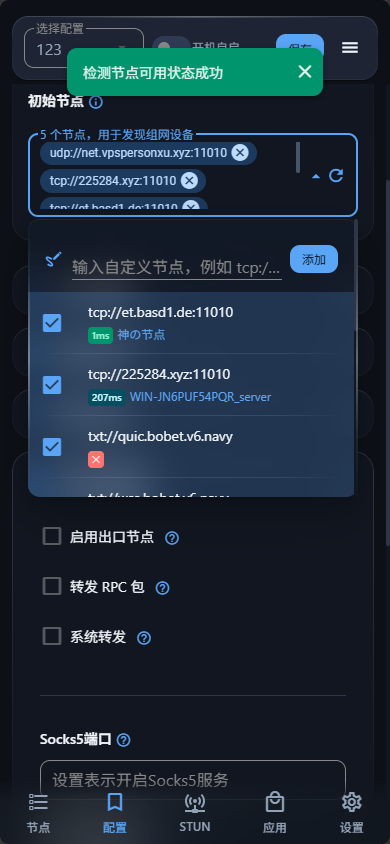 | 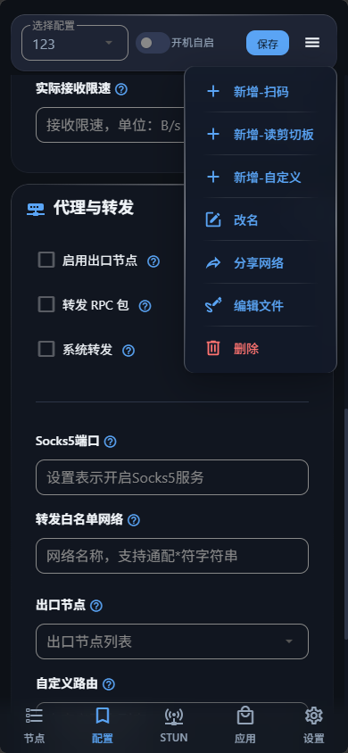 |

| 应用下载                            | 设置 |
|---------------------------------|------|
| 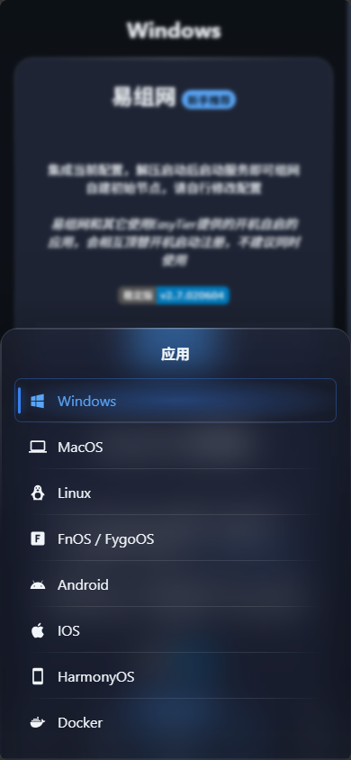 | 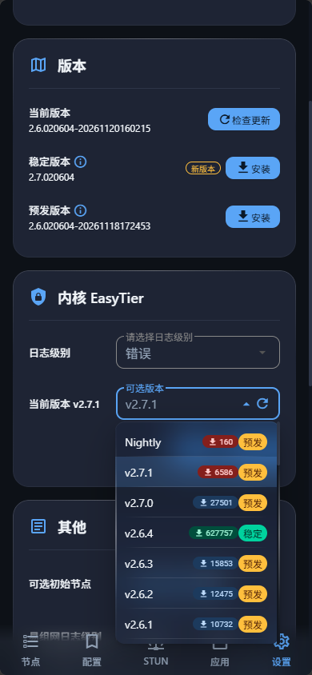 |

## Android 版本说明

### 实现原理

Android 版本与桌面版采用不同的技术方案，但共享同一套 Python 后端和 Vue 前端代码：

| 层级 | 桌面版 | Android 版 |
|------|--------|------------|
| UI 框架 | pywebview | Android WebView |
| Python 嵌入 | 系统 Python | Chaquopy 17.0.0 (Python 3.12) |
| EasyTier 核心 | 子进程调用 CLI | FFI 直接调用 `libeasytier_ffi.so` |
| 虚拟网卡 | 系统 TUN 设备 | Android VPN Service |
| 前端 | Vue 3 + Varlet UI | 同桌面版（复用） |

### 权限说明

- **VPN 权限**：首次启动组网时，系统会弹出 VPN 连接授权对话框，需点击「允许」才能创建虚拟网卡
- **通知权限**（Android 13+）：用于显示组网运行状态通知，告知用户 VPN 正在运行。支持自适应中/英文显示，显示 VPN 运行时长
- **存储权限**：用于保存配置文件、日志等数据

### 使用注意事项

1. **VPN 独占**：Android 系统仅允许同时运行一个 VPN 服务。若启动了其他 VPN 应用（如加速器、广告拦截器等），易组网 VPN 会被系统断开，并收到通知提示
2. **前台服务**：组网运行期间会在通知栏显示「易组网」常驻通知，这是 Android 系统对 VPN 服务的强制要求，无法关闭
3. **后台运行**：建议在系统设置中将易组网加入电池优化白名单，避免后台被系统限制
4. **网络切换**：切换 Wi-Fi 或移动数据时，VPN 会自动重连，无需手动操作
5. **设备架构**：支持 arm64-v8a 和 armeabi-v7a 架构，支持大多数现代 Android 设备（64 位和 32 位 ARM）
6. **启动恢复**：支持打开应用时自动恢复上一次未手动关闭的组网（默认开启）。该功能已迁移到「配置」页面，可按单个配置精细化控制启停
7. **IPv6 与 魔法DNS**：VPN 支持 IPv6 和 魔法DNS，MTU 默认 1300（参考官方 Android 固定值）
8. **内核版本选择**：支持在设置中选择 EasyTier 内核版本
9. **多配置**：Android 支持多配置同时运行（需要 EasyTier 2.7.1 及以上内核版本）
10. **快捷设置磁贴**：可将「易组网」添加到系统快捷设置面板，点击磁贴即可快速启停 VPN，无需打开应用
11. **静默启动**：通过快捷设置磁贴启动 VPN 时，默认不打开 WebView 界面，仅在后台运行并显示系统通知，减少运存占用（参考值：90→60MB）

### 安装方式

前往 [Releases](https://github.com/710850609/EasyTier-EUI/releases) 页面，下载 `EasyTier-EUI-*.apk` 安装包，直接安装即可。

## 技术栈

| 层级   | 桌面版技术                                                               | Android 版技术 |
|------|----------------------------------------------------------------------|--------------|
| 桌面框架 | [pywebview](https://pywebview.flowrl.com/)                           | Android WebView |
| 前端   | [Vue 3](https://vuejs.org/) + [Varlet UI](https://www.varletjs.com/) | 同桌面版（复用）     |
| 后端   | [Python3](https://www.python.org/)                                   | Python 3.12 (Chaquopy) |
| 组网内核 | [EasyTier](https://github.com/EasyTier/EasyTier)                     | EasyTier FFI (`libeasytier_ffi.so`) |
| 原生层  | -                                                                    | Kotlin 2.0.0 + Android VPN Service |

## 开发运行

### 环境要求

| 组件 | 版本 | 用途 |
|------|------|------|
| Python | 3.12+ | 后端运行环境 |
| Node.js | 20+（CI 使用 24 构建） | 前端构建 |
| JDK | 17 | Android 构建 |
| Android SDK + NDK | API 35 / NDK 26 | Android 构建 |

### 准备 EasyTier 核心

后端运行依赖 EasyTier 核心，首次使用需先安装内核。可通过界面「设置」中的内核安装功能下载（会自动适配当前平台），也可手动下载对应平台的 `easytier` 可执行文件放入如下目录：

```
temp/EasyTier-EUI/core/
```

### 后端（Python）

```bash
# 进入后端目录
cd backend

# 创建并激活虚拟环境（Windows）
python -m venv .venv
.venv\Scripts\activate

# 安装依赖
pip install -r requirements-base.txt
pip install -r requirements-gui.txt   # 仅桌面 GUI 需要

# 启动后端服务（默认端口 5666）
python main_noui.py
```

启动后访问 `http://127.0.0.1:5666`，可指定端口：

```bash
python main_noui.py --port 5666 --host 0.0.0.0
```

桌面 GUI 模式（pywebview 窗口 + 系统托盘）：

```bash
python main_ui.py
```

### 前端（Vue 3 + Varlet UI）

```bash
cd frontend

# 安装依赖
npm install

# 开发模式（Vite 热更新，端口 5173）
npm run dev

# 生产构建（输出到 frontend/dist，由后端直接托管）
npm run build
```

开发模式下 Vite 会将 `/cgi` 前缀的接口请求代理到 `http://localhost:5666`（见 `frontend/vite.config.js`），因此只需同时启动后端（`python main_noui.py`）和前端（`npm run dev`），即可在 `http://localhost:5173` 上热更新调试前端。

### Android

Android 端复用同一套 Python 后端和 Vue 前端代码，构建流程：

```bash
# 1. 构建前端产物
cd frontend
npm install
npm run build

# 2. 复制前端产物到 Android assets
mkdir -p ../android/app/src/main/assets/frontend
cp -r dist/* ../android/app/src/main/assets/frontend/

# 3. 放置 FFI 动态库（libeasytier_ffi.so）到对应 ABI 目录
#    APP_DIR/android/app/src/main/jniLibs/arm64-v8a/

# 4. 用 Android Studio 打开 android 目录构建，或命令行构建
cd android
./gradlew assembleDebug
```

Android 构建需注意：

- Chaquopy 嵌入的是 Python 3.12，本机需安装 Python 3.12 并可在 PATH 中找到（`python3.12`）
- FFI 动态库 `libeasytier_ffi.so` 由 EasyTier 源码编译产出，需按 ABI（arm64-v8a / armeabi-v7a）分别放置，见 `.github/workflows/build-android.yml`
- 内核版本支持在 Android 端「设置」页面在线选择安装

## 其他链接

- <a href="https://github.com/EasyTier/EasyTier" target="_blank" rel="noopener noreferrer">EasyTier 源码</a>
- <a href="https://easytier.cn" target="_blank" rel="noopener noreferrer">EasyTier 文档</a>
- <a href="https://www.varletjs.com/#/zh-CN" target="_blank" rel="noopener noreferrer">Varlet 文档</a>

## 贡献

欢迎提交 Issue 和 Pull Request！

- 🐛 [提交 Bug 反馈](https://github.com/710850609/EasyTier-EUI/issues/new?template=bug_report.yml)
- ✨ [提出功能建议](https://github.com/710850609/EasyTier-EUI/issues/new?template=feature_request.yml)

## 支持项目

如果这个项目对你有帮助，欢迎 **Star ⭐** 或是 赞赏 支持！

<p align="center">
  
</p>

## 开源协议

本项目基于 [GPL-3.0 License](LICENSE) 开源。